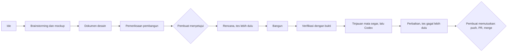

import BookChapter from '../../components/project-library/BookChapter.astro';

<BookChapter id="prologue" title="Prolog · Mengapa kisah ini ada">

_Kisah sebuah alat kecil yang hidup di browser, dan cara ia dibuat oleh satu orang yang bekerja bersama dua alat pemrograman AI._

Proyek ini punya dua tugas.

Pertama, menjadi pembuat resume yang benar-benar berfungsi: [resume.lab.adityapryg.dev](https://resume.lab.adityapryg.dev).

Kedua, menjadi **contoh nyata cara pembuatnya membangun perangkat lunak bersama Claude Code dan Codex**. Kodenya adalah produknya, tetapi cara membuatnya adalah demonstrasinya. Maka kisah ini menceritakan keduanya: apa yang dibangun, dan bagaimana pembuatnya, Claude Code, dan Codex mengerjakannya. Setiap bab ditutup dengan catatan singkat _Di balik halaman_, dan Bab 6 menyatukan seluruh alur kerja dalam satu halaman.

</BookChapter>

<BookChapter id="the-hero" title="Bab 1 · Sang tokoh">

Alkisah, hiduplah sebuah pembuat resume.

Ia tidak punya server dan tidak punya akun. Ia hanya mengingat apa yang diizinkan browser untuk disimpan, sehingga semua yang ditulis seseorang tetap berada di browsernya sendiri. Ketika pekerjaan selesai, dialog cetak browser mengubahnya menjadi PDF, dan tidak ada orang lain yang pernah melihat satu kata pun.

Ia berbicara dua bahasa, Indonesia dan Inggris, dan dapat menyimpan kedua versi dari satu resume sekaligus. Hal-hal yang tidak pernah berubah, seperti tanggal, kontak, dan foto, ditulis satu kali. Hanya kata-katanya yang diceritakan dua kali.

Ia dibuat dari Svelte, Vite, Tailwind, dan TypeScript, dan ia berhati-hati. Ia tidak pernah memercayai apa pun yang diberikan kepadanya. Setiap berkas diperiksa, setiap tautan diteliti, dan berkas dari versi yang lebih baru dari dirinya ditolak dengan sopan.

Di balik halaman

Pembuatnya menuliskan aturan rumah dalam berkas `AGENTS.md`, agar setiap sesi AI bermula dari fakta yang sama: perintah, arsitektur, dan keputusan ganjil yang tampak keliru tetapi disengaja. Claude Code dan Codex sama-sama membacanya.

</BookChapter>

<BookChapter id="two-faces" title="Bab 2 · Dua wajah untuk satu kertas">

Sang tokoh menampilkan setiap resume dengan dua cara.

**Classic** untuk manusia: halaman bersih dengan sedikit warna. **ATS** untuk mesin yang membaca resume sebelum manusia mana pun, dengan tata letak sederhana dan urutan baca yang tidak pernah berubah. Sebuah skrip membaca ulang PDF hasil ekspor dan memeriksa bahwa urutannya benar, karena sang tokoh lebih peduli dibaca dengan benar daripada tampil memikat.

Di balik halaman

Browser tiruan dalam tes tidak dapat memberi tahu di mana halaman terpotong atau dalam urutan apa sebuah PDF dibaca. Karena itu alur kerjanya menyertakan pemeriksaan nyata (`verify:ats`, `verify:print`) yang menjalankan Chromium tanpa antarmuka. Pemeriksaan ini dijalankan setelah apa pun yang dapat menyentuh halaman cetak.

</BookChapter>

<BookChapter id="a-real-cv" title="Bab 3 · Hari ketika CV sungguhan datang">

Suatu hari, seseorang membawa CV hasil ekspor dari Word. Sang tokoh mencoba membacanya dan bingung. Judul bagian memakai kata yang tidak dikenalnya, nama diberi label sebagai teks biasa, dan butir-butirnya terpecah di antara halaman, sehingga ceritanya berantakan.

Sang tokoh belajar membaca seperti manusia, yaitu dengan melihat. Teks terbesar dan paling tebal kemungkinan adalah judul. Baris dengan gaya yang sama seperti baris lain kemungkinan judul yang lain pula. Ketika huruf tidak memberi petunjuk, sang tokoh kembali pada aturan lama.

Ia membuat tiga janji pada dirinya sendiri:

- **Ia tidak akan mengarang apa pun.**
- **Ia tidak akan menulis ulang atau menerjemahkan apa yang dibacanya.**
- **Apa pun yang tidak diyakininya dibiarkan kosong** dan didaftar sebagai belum ditempatkan, agar orangnya yang memutuskan.

Ia bahkan belajar membaca halaman hasil pindai, dengan tingkat kesalahan karakter 0,91%. Ia mengukur dirinya pada delapan resume rekaan, dan kini sebuah tes akan gagal bila ada isian yang dulu keluar dengan benar tiba-tiba keluar salah. Ia juga mengakui keterbatasannya: kadang pembaca yang dipinjamnya mengubah satu kata, atau menggabungkan dua baris kursus menjadi satu, dan sang tokoh mengatakannya terus terang.

Di sepanjang jalan ia mendapat dua bagian baru, **Kursus & Sertifikasi** dan **Referensi**, karena resume sungguhan memilikinya.

Di balik halaman

Ini pekerjaan terbesar, sehingga dijalankan secara **subagent-driven**: sebuah desain, rencana dua belas tugas, dan untuk setiap tugas satu pembantu baru yang membangunnya dan satu lagi yang meninjaunya, dengan putaran perbaikan di antaranya. CV asli tidak pernah masuk ke repositori. CV itu hanya dibaca dari folder privat, dan setiap fixture tes memakai tokoh rekaan.

</BookChapter>

<BookChapter id="taking-things-back" title="Bab 4 · Kuasa untuk menarik kembali">

Penyimpanan otomatis sang tokoh cepat tetapi tidak kenal ampun. Entri yang terhapus hilang selamanya, sehingga Hapus bertanya dua kali.

Maka sang tokoh belajar **undo**. **Ctrl+Z** membatalkan perubahan terakhir, apa pun itu: entri yang dihapus, bagian yang disembunyikan, hasil impor, bahkan Mulai kosong. **Ctrl+Shift+Z** mengembalikannya. Mengetik di sebuah isian tetap memakai undo bawaan isian itu, dan segala hal lain dihitung satu perubahan selesai pada satu waktu. Sang tokoh mengingat hingga seratus langkah dan melupakannya ketika tab ditutup. Hapus tetap bertanya dua kali, karena dua jaring pengaman lebih baik daripada satu.

Para peninjau membaca hasil kerja ini seperti orang asing di tengah jalan, dan mereka menemukan retakan: foto yang kehilangan izinnya, bunyi berulang yang dilewati pembaca layar, pintasan yang aktif di dalam dialog, dan tombol Undo yang tetap mati pada suntingan pertama. Setiap retakan diperbaiki, dengan tes yang gagal lebih dulu.

Di balik halaman

Undo kecil dan saling terkait erat, lima tugas yang saling bersambung, sehingga dijalankan secara **native**: satu sesi membangun setiap tugas sendiri, lalu satu peninjau baru pada model terkuat membaca seluruh cabang. Setelah itu Codex memberi pendapat kedua lewat _tinjauan adversarial_, yang tidak memburu salah ketik tetapi menantang pendekatannya. Ia menemukan tombol Undo yang mati, dan itu diperbaiki sebelum apa pun dirilis.

</BookChapter>

<BookChapter id="the-lamp" title="Bab 5 · Sang lampu">

Pembuatnya punya panduan tentang cara menulis resume yang baik, dan ingin sang tokoh membagikannya sebagai sebuah kisah, bukan daftar periksa.

Maka sang tokoh menumbuhkan **lampu**. Ketika sebuah resume sudah punya nama, judul, dan sesuatu yang layak ditanyakan, lampu itu menyala tiga kali dengan lembut, lalu tetap menyala. Bagi siapa pun yang meminta perangkatnya mengurangi gerakan, lampu itu langsung menyala dan tidak bergerak.

Tekan lampunya, dan sang tokoh menceritakan kembali resume Anda:

> _Alkisah, hiduplah seorang Learning & Development Specialist bernama Dewi Lestari…_

Kisahnya berjalan bab demi bab: **Judul, Ringkasan Profil, Kompetensi, Pengalaman Kerja, Pendidikan, Kursus, Referensi**. Bila ada yang kurang, kisah berhenti dan bertanya. _Sudah berapa tahun sang tokoh menempuh jalan ini? Tugas mana yang benar-benar miliknya? Di mana ia mengambil kursusnya?_ Setiap pertanyaan boleh dilewati.

Sang tokoh tidak pernah menghakimi. Ia memperhatikan dan bertanya.

Ketika seseorang menjawab, sang tokoh menuliskannya ke dalam resume dengan pola kalimat dari panduan itu, dalam bahasa resume, tanpa AI dan tanpa server, dan tidak pernah mengarang satu kata pun. Apa yang ditulisnya tetap disorot di layar, tidak pernah di cetakan, sampai orangnya menyuntingnya. Setiap halaman yang dibalik adalah satu langkah undo. Setiap isian kosong juga membisikkan maknanya, sebagai tip kecil yang melayang di desktop dan sebagai pita di bawah baris di ponsel.

Di balik halaman

Inilah seluruh alur kerja dalam bentuk mini. Semuanya bermula dari satu kalimat pembuatnya ("ikon lampu, dan saya ingin tampilannya seperti seorang pencerita") dan menjadi percakapan, tiga mockup untuk dipilih, desain tertulis, rencana, dan pembangunan. Di tengah jalan, **Codex** mengambil alih sesi dan membangun inti kisah dengan pembantunya sendiri, sampai batas penggunaannya habis. **Claude Code** lalu melanjutkan dari buku catatan kemajuan, menyelesaikan layar-layarnya, dan menjalankan tinjauan akhir. Tip ditambahkan setelahnya, dari prototipe yang dapat diklik yang bisa dicoba lebih dulu oleh pembuatnya.

</BookChapter>

<BookChapter id="the-workflow" title="Bab 6 · Alur kerja">

Setiap fitur di proyek ini melalui putaran yang sama. Tidak ada yang ajaib di dalamnya. Ini hanya kumpulan kebiasaan yang menjaga pembuatnya tetap memegang kendali dan para pembantu tetap jujur.

1. **Brainstorming.** Satu pertanyaan pada satu waktu, dimulai dari yang terbuka: _ceritakan saat ketika ini akan membantu._ Asisten memutar ulang ide itu dalam potongan pendek dan menandai tebakannya sendiri sebagai tebakan. Ketika melihat lebih baik daripada membaca, ia membuka tab browser berisi mockup, seperti yang dilakukannya untuk tata letak buku cerita.
2. **Dokumen desain.** Ide yang disepakati dituliskan: tujuan, bukan-tujuan, dan hal-hal yang dianggap kegagalan.
3. **Pemeriksaan pembangun.** Pembantu baru yang belum melihat percakapan membaca desain itu seolah harus membangunnya, dan hanya mendaftar pertanyaan yang tidak dapat dijawabnya. Sebagian jawaban datang dari pembuatnya, sisanya adalah keputusan asisten, yang ditandai demikian.
4. **Gerbang persetujuan.** Tidak ada yang dibangun sebelum pembuatnya menyetujui desain.
5. **Rencana.** Tugas-tugas kecil, masing-masing dimulai dengan tes yang gagal. Rencana menyalin aturan keras desain kata demi kata, dan mendaftar kasus yang paling mungkin menimpa orang sungguhan.
6. **Bangun.** Dua mode, dipilih per fitur menurut ukuran dan risikonya: **subagent-driven** (pembangun baru dan peninjau baru untuk setiap tugas) atau **native** (satu sesi membangun semuanya, lalu satu peninjau baru).
7. **Buku catatan.** Setiap rencana menyimpan berkas kemajuan dengan satu baris per tugas selesai dan catatan setiap pertimbangan: apa yang diputuskan, mengapa, dan apa akibatnya bila keliru. Ketika sebuah sesi kehilangan ingatan atau alat lain mengambil alih, buku catatan dan `git log` menjadi ingatannya.
8. **Verifikasi dengan bukti.** Rangkaian tes, pemeriksaan tipe, build, pemeriksaan ATS dan cetak di browser sungguhan, serta tangkapan layar yang benar-benar dilihat oleh seseorang.
9. **Tinjauan.** Peninjau baru pada model terkuat membaca seluruh cabang. Codex menambahkan pendapat kedua, dan kadang yang adversarial. Temuan dinilai ulang menurut apa yang akan dialami orang yang memakai aplikasinya, dan setiap perbaikan dimulai dengan tes yang gagal. Hal-hal kecil didaftar dan ditunda, tidak pernah diperbaiki diam-diam.
10. **Pembuat memutuskan.** Push, membuka pull request, merge, dan menulis ulang riwayat semuanya menunggu jawaban ya.

Siapa melakukan apa:

|                 | Memutuskan                                                                | Mengerjakan                                                                                                |
| --------------- | ------------------------------------------------------------------------- | ---------------------------------------------------------------------------------------------------------- |
| **Pembuat**     | Apa yang dibangun dan mengapa; persetujuan; kapan dirilis; aturan privasi | Menjelaskan, memilih di antara opsi, mencoba hasilnya                                                      |
| **Claude Code** | Keputusan kecil di dalam rencana, dicatat di buku catatan                 | Brainstorming, desain, dan rencana; sebagian besar pembangunan; mengatur pembantu dan peninjau; verifikasi |
| **Codex**       | Tidak ada di luar tugasnya                                                | Tinjauan pendapat kedua; pernah mengambil alih satu sesi untuk membangun inti pencerita                    |

Alur kerja ini juga punya beberapa aturan yang tidak pernah dilonggarkan:

- **Data privat tetap privat.** CV asli tidak pernah di-commit, dan tes memakai tokoh rekaan.
- **Ide yang belum siap dituliskan,** di berkas catatan dan memori, agar kembali pada gilirannya dan tidak hilang atau dikerjakan setengah jadi.
- **Sebutkan apa yang sudah dan belum diverifikasi.** Bila sebuah tinjauan dihentikan lebih awal atau sebuah pemeriksaan tidak dijalankan, laporan mengatakannya.

Tidak selalu rapi. Satu tinjauan Codex dihentikan sebelum melaporkan apa pun. Seorang pembantu pernah kehabisan tenaga di tengah sebuah bab. Sebuah tes gagal karena browser tiruan di dalam tes tidak berperilaku seperti yang asli. Semuanya diperhatikan, dikatakan terus terang, lalu diperbaiki atau dicarikan jalan keluarnya, dan itu juga bagian dari demonstrasi ini.

</BookChapter>

<BookChapter id="still-unwritten" title="Bab 7 · Yang belum tertulis">

Tidak semua bab sudah selesai:

- **Suara.** Pencerita belum bisa membaca dengan lantang. Teks dulu, baru suara.
- **Tautan dan cetak tebal.** Kontak yang dapat diklik, tautan perusahaan, dan kata tebal di dalam kalimat ditunda untuk hari lain.
- **Pilihan kata.** Kisah berbahasa Indonesia masih mencampur _kamu_ dan _Anda_.

</BookChapter>

<BookChapter id="the-end" title="Akhir, untuk sementara">

Maka sang tokoh melangkah terus, sedikit lebih berani. Ia dapat membaca CV orang asing, menarik kembali kesalahan, dan menceritakan kembali kisah seseorang kepada pemiliknya, dengan cukup lembut sehingga mereka ingin menulisnya lebih baik. Dan cara pembuatannya, dengan seorang manusia yang memegang kendali, dua alat yang membantu, dan semuanya diperiksa, adalah separuh lain dari kisah ini.

_Bersambung._

</BookChapter>

<BookChapter id="the-facts" title="Fakta di balik kisah">

|                |                                                                                        |
| -------------- | -------------------------------------------------------------------------------------- |
| Situs langsung | [resume.lab.adityapryg.dev](https://resume.lab.adityapryg.dev)                         |
| Sumber         | [github.com/adtyprayoga/resume](https://github.com/adtyprayoga/resume)                 |
| Teknologi      | Svelte 5, Vite, Tailwind v4, TypeScript, Bun                                           |
| Dibuat dengan  | Claude Code dan Codex, diarahkan oleh pembuatnya                                       |
| Impor          | Docling dan Tesseract di Docker, dibaca lewat huruf lebih dulu, lalu aturan            |
| Akurasi OCR    | Kesalahan karakter 0,91% pada berkas uji hasil pindai                                  |
| Bagian         | Pengalaman, Pendidikan, Proyek, Keahlian, Penghargaan, Kursus & Sertifikasi, Referensi |
| Undo           | Hingga 100 langkah, hanya konten, hilang saat tab ditutup                              |
| Pencerita      | 7 bab, templat dalam bahasa Inggris dan Indonesia, tanpa AI, tanpa server              |
| Tes            | Lebih dari 1.200 lulus per 5 November 2026                                             |

</BookChapter>
