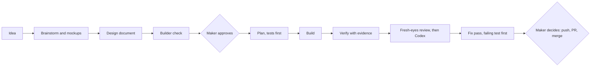

import BookChapter from '../../components/project-library/BookChapter.astro';

<BookChapter id="prologue" title="Prologue · Why this story exists">

*The story of a small tool that lives in the browser, and of the way it was built by one person working with two AI coding tools.*

This project has two jobs.

The first is to be a real, working resume builder: [resume.lab.adityapryg.dev](https://resume.lab.adityapryg.dev).

The second is to be a **worked example of how its maker builds software with Claude Code and Codex**. The code is the product, but the way it was made is the demonstration. So this story tells both: what was built, and how the maker, Claude Code and Codex went about it. Each chapter ends with a short *Behind the page* note, and Chapter 6 puts the whole workflow on one page.

</BookChapter>

<BookChapter id="the-hero" title="Chapter 1 · The hero">

Once upon a time, there lived a resume builder.

It had no server and no account. It remembered only what the browser let it keep, so everything a person wrote stayed in their own browser. When the work was done, the browser's own print dialog turned it into a PDF, and nobody else ever saw a word.

It spoke two languages, Indonesian and English, and could hold both versions of one resume at once. Things that never change, such as dates, contact details and the photo, were written down once. Only the words were told twice.

It was built from Svelte, Vite, Tailwind and TypeScript, and it was careful. It never trusted anything it was handed. Every file was checked, every link was inspected, and a file from a newer version of itself was politely refused.

> **Behind the page.** The maker wrote down the rules of the house in an `AGENTS.md` file, so that every AI session starts from the same facts: the commands, the architecture, and the odd decisions that look wrong but are deliberate. Claude Code and Codex both read it.

</BookChapter>

<BookChapter id="two-faces" title="Chapter 2 · Two faces for one paper">

The hero showed every resume in two ways.

**Classic** was for people: a clean page with a little colour. **ATS** was for the machines that read resumes before any person does, with a plain layout and a reading order that never changes. A script reads the exported PDF back and checks that the order is right, because the hero cared more about being read correctly than about looking clever.

> **Behind the page.** A fake browser in a test cannot tell you where a page breaks or what order a PDF reads in. So the workflow includes real checks (`verify:ats`, `verify:print`) that drive a headless Chromium. They run after anything that could touch the printed page.

</BookChapter>

<BookChapter id="a-real-cv" title="Chapter 3 · The day a real CV arrived">

One day, someone brought a CV exported from Word. The hero tried to read it and got confused. Headings had wording it didn't know, the name was labelled as ordinary text, and bullets had split across pages, so the story fell apart.

The hero learned to read the way a person does, by looking. The biggest, boldest text is probably a heading. A line in the same style as the others is probably another heading. When the fonts say nothing, the hero falls back to the old rules.

It made itself three promises:

- **It would never invent anything.**
- **It would never reword or translate what it read.**
- **Anything it wasn't sure of stayed blank** and was listed as unplaced, for the person to decide.

It even learned to read scanned pages, with a character error rate of 0.91%. It measured itself on eight made-up resumes, and a test now fails if a field that used to come out right ever comes out wrong. It also admitted its limits: sometimes the reader it borrowed alters a word, or merges two course lines into one, and the hero says so.

Along the way it gained two new sections, **Courses & Certifications** and **References**, because real resumes have them.

> **Behind the page.** This was the biggest piece of work, so it ran **subagent-driven**: a design, a twelve-task plan, and for each task a fresh helper to build it and another to review it, with fix rounds in between. The real CV never entered the repository. It was read only from a private folder, and every test fixture uses invented people.

</BookChapter>

<BookChapter id="taking-things-back" title="Chapter 4 · The power to take things back">

The hero's autosave was quick but unforgiving. A deleted entry was gone for good, so Delete asked twice.

So the hero learned **undo**. **Ctrl+Z** takes back the latest change, whatever it was: a deleted entry, a hidden section, an import, even Start blank. **Ctrl+Shift+Z** brings it back. Typing in a field keeps the field's own undo, and everything else counts one finished change at a time. The hero remembers up to a hundred steps and forgets them when the tab closes. Delete still asks twice, because two safety nets are better than one.

Reviewers read the work like strangers on a road, and they found cracks: a photo that lost its permission, a repeated sound that screen readers skipped, a shortcut that fired inside a dialog, and an Undo button that stayed dead for the very first edit. Each crack was fixed, with a test that failed first.

> **Behind the page.** Undo was small and tightly connected, five tasks that built on each other, so it ran **native**: one session built every task itself, then one fresh reviewer on the strongest model read the whole branch. Afterwards Codex gave a second opinion with an *adversarial review*, which doesn't hunt for typos but challenges the approach. It found the dead Undo button, which was fixed before anything shipped.

</BookChapter>

<BookChapter id="the-lamp" title="Chapter 5 · The lamp">

The maker had a guide on how a good resume is written, and wanted the hero to share it, as a story rather than a checklist.

So the hero grew a **lamp**. When a resume has a name and a headline and something worth asking about, the lamp glows three times, softly, and then stays lit. For anyone who asked their device for less motion, it simply stays lit.

Press it, and the hero tells your resume back to you:

> *Once upon a time, there lived a Learning & Development Specialist called Dewi Lestari…*

The story goes chapter by chapter: **Headline, Profile Summary, Competencies, Working Experience, Education, Course, References**. Where something is missing, the story stops and asks. *How many years has our hero walked this road? Which duty was truly hers? Where did she take her course?* Every question can be skipped.

The hero never judges. It notices and asks.

When someone answers, the hero writes it into the resume with the guide's own sentence patterns, in the resume's language, with no AI and no server, and never invents a word. What it wrote stays highlighted on screen, never in print, until the person edits it. Each page turned is one step of undo. Each blank also whispers its meaning, as a small floating tip on a desktop and as a band under the line on a phone.

> **Behind the page.** This is the whole workflow in miniature. It began as a sentence from the maker ("a lamp icon, and I want it to look like a storyteller") and became a conversation, three mockups to choose from, a written design, a plan, and a build. Midway, **Codex** took over the session and built the story's core with its own helpers, until it reached its usage limit. **Claude Code** then picked up the ledger, finished the screens and ran the final review. The tips were added afterwards, from a clickable prototype the maker could try first.

</BookChapter>

<BookChapter id="the-workflow" title="Chapter 6 · The workflow">

Every feature in this project went through the same loop. Nothing in it is magic. It is a set of habits that keep the maker in charge and the helpers honest.

1. **Brainstorm.** One question at a time, starting with an open one: *walk me through the moment this would help.* The assistant plays the idea back in short pieces and marks its own guesses as guesses. When seeing beats reading, it opens a browser tab with mockups, as it did for the storybook's layout.
2. **Design document.** The agreed idea is written down: goals, non-goals, and the things that would count as failure.
3. **Builder check.** A fresh helper that has seen none of the conversation reads the design as if it had to build it, and lists only the questions it couldn't answer. Some answers come from the maker, and the rest are the assistant's calls, marked as such.
4. **Approval gate.** Nothing is built until the maker approves the design.
5. **Plan.** Small tasks, each starting with a test that fails. The plan copies the design's hard rules word for word, and lists the cases most likely to bite a real person.
6. **Build.** Two modes, chosen per feature by size and risk: **subagent-driven** (a fresh builder and a fresh reviewer for every task) or **native** (one session builds everything, then one fresh reviewer).
7. **Ledger.** Every plan keeps a progress file with one line per finished task and a record of every judgement call: what was decided, why, and what it costs if wrong. When a session loses its memory or a different tool takes over, the ledger and `git log` are the memory.
8. **Verify with evidence.** The test suite, the type check, the build, the real-browser ATS and print checks, and screenshots that a person actually looks at.
9. **Review.** A fresh reviewer on the strongest model reads the whole branch. Codex adds a second opinion, and sometimes an adversarial one. Findings are re-graded by what a person using the app would meet, and each fix starts with a failing test. Small things are listed and deferred, never quietly fixed.
10. **Maker decides.** Pushing, opening a pull request, merging and rewriting history all wait for a yes.

Who does what:

| | Decides | Does |
|---|---|---|
| **The maker** | What gets built and why; approvals; when to ship; privacy rules | Describes, chooses between options, tries the result |
| **Claude Code** | Small calls inside the plan, recorded in the ledger | Brainstorming, designs and plans; much of the building; orchestrating helpers and reviewers; verification |
| **Codex** | Nothing outside its task | Second-opinion reviews; took over a session to build the storyteller's core |

The workflow also has a few rules that never bend:

- **Private data stays private.** A real CV is never committed, and tests use invented people.
- **Ideas that aren't ready get written down,** in a notes file and a memory, so they come back when their turn comes instead of being lost or half-built.
- **Say what was and wasn't verified.** If a review was stopped early or a check wasn't run, the report says so.

It isn't tidy every time. One Codex review was stopped before it reported anything. A helper once ran out of strength in the middle of a chapter. A test failed because the fake browser in the test doesn't behave like the real one. Each of those was noticed, said out loud, and fixed or worked around, and that is part of the demonstration too.

</BookChapter>

<BookChapter id="still-unwritten" title="Chapter 7 · What is still unwritten">

Not every chapter is finished:

- **The voice.** The storyteller cannot read aloud yet. First the text, then the sound.
- **Links and bold.** Clickable contact details, company links, and bold words inside sentences were set aside for another day.
- **The wording.** The Indonesian story still mixes *kamu* and *Anda*.

</BookChapter>

<BookChapter id="the-end" title="The end, for now">

And so the hero went on, a little braver. It could read a stranger's CV, take back a mistake, and tell a person's own story back to them, gently enough that they wanted to write it better. And the way it was made, with a person in charge, two tools helping, and everything checked, is the other half of the story.

*To be continued.*

</BookChapter>

<BookChapter id="the-facts" title="The facts behind the story">

| | |
|---|---|
| Live site | [resume.lab.adityapryg.dev](https://resume.lab.adityapryg.dev) |
| Source | [github.com/adtyprayoga/resume](https://github.com/adtyprayoga/resume) |
| Stack | Svelte 5, Vite, Tailwind v4, TypeScript, Bun |
| Built with | Claude Code and Codex, directed by the maker |
| Import | Docling and Tesseract in Docker, read by fonts first, then rules |
| OCR accuracy | 0.91% character error on the scanned test file |
| Sections | Experience, Education, Projects, Skills, Awards, Courses & Certifications, References |
| Undo | Up to 100 steps, content only, gone when the tab closes |
| Storyteller | 7 chapters, templates in English and Indonesian, no AI, no server |
| Tests | More than 1,200 passing as of 5 November 2026 |

</BookChapter>
